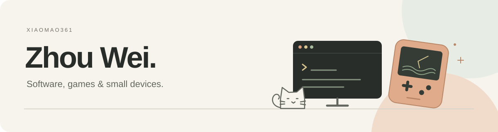

  

<h3 align="center">写点软件，做点游戏。</h3>

  Mac 和 iPhone 上的小工具，放进口袋里的游戏。 
  <a href="https://xiaomao361.github.io/zhou-wei.com/">个人网站</a> · <a href="https://github.com/xiaomao361?tab=repositories">全部仓库</a>

### 应用

| 项目 | 用途 | 下载 |
| :--- | :--- | :--- |
| [收下](https://xiaomao361.github.io/shouxia/) | 从短信、文字和截图整理取件码，用小组件查看，或分享给代取的人。 | [App Store · 1.3.2](https://apps.apple.com/cn/app/id6795735956) |
| [搁这儿](https://xiaomao361.github.io/dockshelf/) | Mac 菜单栏文件搁板。暂存引用，需要时拖到别的应用，原文件留在原处。 | [macOS · 0.1.5](https://github.com/xiaomao361/dockshelf/releases/latest) |
| [croc for macOS](https://github.com/xiaomao361/croc-gui) | croc 的独立原生界面，用口令收发文件、查看进度和传输结果。 | [macOS · 0.3.2](https://github.com/xiaomao361/croc-gui/releases/latest) |
| [ClaraCore Desktop](https://xiaomao361.github.io/claracore-desktop/) | 在本地保存智能体记忆、项目进度和 Markdown 资料，通过 MCP 连接不同客户端。 | [macOS / Windows · 1.0.6](https://github.com/xiaomao361/claracore-desktop/releases/latest) |

### Radwater · 余波

水质尚未达标，垂钓照常进行。

一个可以随时放下的废土钓鱼故事。钓鱼，翻看旧物上的记录，拼出水边发生过的事。

**AI Passport 版「余波：暮湾」已发布。** 三处水岸、四章故事，16 种鱼和 24 类旧物。离线游玩，咬钩会等你，关机后可以接着之前的进度继续。

| 版本 | 入口 |
| :--- | :--- |
| AI Passport · 0.5.1 | [社区页面与安装](https://ai-passport.folotoy.cn/plays/1690/) |
| Cardputer ADV 原版 | [源码与固件](https://github.com/xiaomao361/radwater) |

  

### 开发工具

| 项目 | 用途 |
| :--- | :--- |
| [ClaraCore Server](https://github.com/xiaomao361/claracore-server) | 自托管的团队记忆与知识服务，按成员和空间管理访问权限。 |
| [DSH Capability Gateway](https://github.com/xiaomao361/dsh-capability-gateway) | 给 DeepSeek Harness 按需查找和调用 Skills、MCP 工具。 |
| [Cora](https://github.com/xiaomao361/cora) | 把应用报错归成问题，保存处理记录，通过 HTTP 和 MCP 查询。 |

### 制作中

- **微境 · Microcosm**：AI Passport 上的离线小生态。选择环境，放入生命，看它们觅食、跟随和避让。
- **Wick**：五章离线小故事。一个小生灵发现远处的灯灭了，修好自己的灯，背上行囊出发。
- **INK CREW**：通过蓝牙显示观察到的 Codex 工作状态和账号额度。个人改版，基于 [zt20 的 Codex Usage](https://github.com/zt20/codex-usage-ai-passport)。

这三项暂未公开下载。[网站上的开发预览](https://xiaomao361.github.io/zhou-wei.com/#in-progress)。

---

(｡◝‿◜｡)

